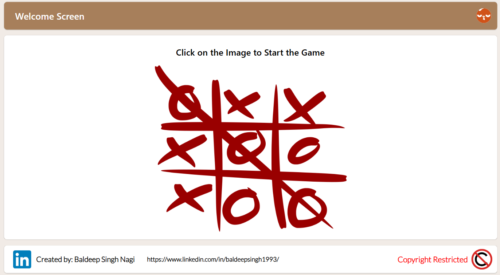
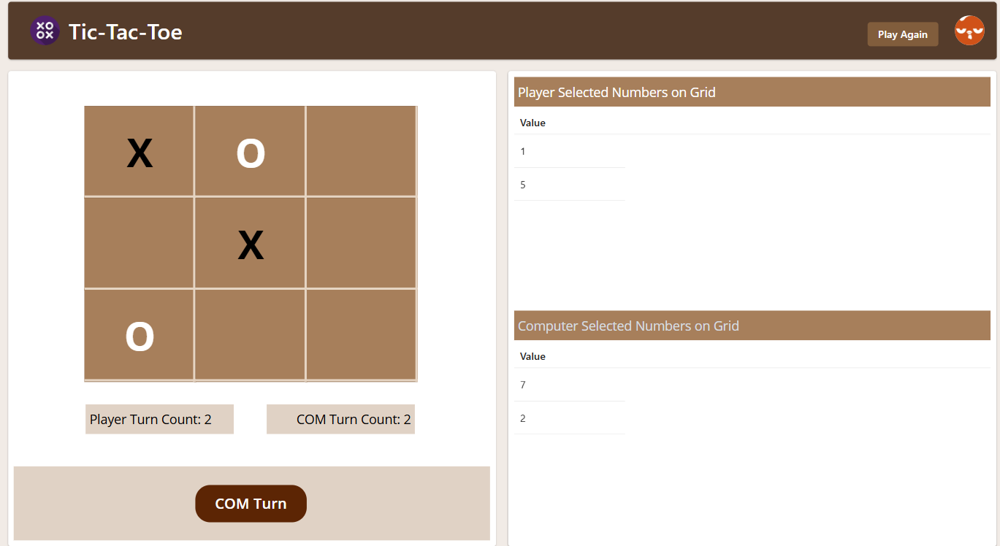

# 🎮 Tic-Tac-Toe | Microsoft Power Apps Canvas App

A fully functional Tic-Tac-Toe game built using **Microsoft Power Apps Canvas Apps** and **Power Fx**, demonstrating how traditional game logic can be implemented in a low-code environment without external data sources.

---

## 👨‍💻 About the Developer

Hi! I'm **Baldeep Singh**, a Tech Lead passionate about application development, automation, and Microsoft Power Platform.

This project is part of my Power Apps learning journey, where I explored how to build interactive applications, implement game logic, and create engaging user experiences entirely within Canvas Apps.

### Connect with Me

- **GitHub:** [@baldeep1993](https://github.com/baldeep1993)
- **LinkedIn:** [Baldeep Singh](https://www.linkedin.com/in/baldeepsingh1993/)

---

# 📌 Project Overview

This project is a complete implementation of the classic **Tic-Tac-Toe** game built entirely in **Microsoft Power Apps Canvas Apps**.

The application allows a user to play against a computer opponent while showcasing advanced use of Power Fx, collections, variables, conditional logic, and dynamic state management.

No external database, SharePoint list, Dataverse table, or API is required. All gameplay logic is executed directly within the Canvas App.

---

# ✨ Key Features

## 🎯 Play Against Computer

- Single-player Tic-Tac-Toe experience
- Computer automatically makes moves
- Dynamic turn-based gameplay
- Fully implemented game logic using Power Fx

---

## 👋 Welcome Screen

A dedicated welcome screen has been added to provide a better user experience before entering the game.

### Benefits

- Professional application flow
- Improved user onboarding experience
- Clean navigation into gameplay

---

## 🎬 Animated Game Experience

A GIF animation has been added to the main game screen to make the application more engaging and visually appealing.

---

## 🛡️ Smart Cell Selection Validation

To maintain fair gameplay, users are prevented from selecting cells that have already been chosen.

### Validation Logic

- Previously selected cells cannot be selected again
- Prevents accidental overwriting of moves
- Ensures game board integrity throughout the match

---

## 🔄 Turn Counter Tracking

The application includes dedicated counters that track:

- Number of turns played by the Player
- Number of turns played by the Computer

This provides visibility into game progression and assists with game-state management.

---

## 🏆 Win / Lose / Draw Detection

The application automatically evaluates gameplay and determines:

- ✅ Player Win
- ✅ Computer Win
- ✅ Draw Match

Winning combinations are dynamically validated using Power Fx collections.

---

## ⚡ Power Fx Driven Architecture

The application leverages:

- Collections
- Variables
- Dynamic Sequences
- Conditional Logic
- State Management
- Turn Tracking
- Winning Combination Evaluation

All business logic is implemented using **Power Fx** without external dependencies.

---

# 🚀 Final Release Highlights

✅ Fully playable Tic-Tac-Toe game

✅ User vs Computer gameplay

✅ Welcome screen implementation

✅ Animated GIF on game launch

✅ Smart validation to prevent duplicate cell selections

✅ Player turn counter

✅ Computer turn counter

✅ Win, Loss, and Draw detection

✅ Power Fx-based game engine

✅ No external data sources

✅ Built entirely with Microsoft Power Apps

---

# 🛠️ Technology Stack

| Technology | Purpose |
|------------|---------|
| Microsoft Power Apps | Application Development |
| Canvas Apps | User Interface |
| Power Fx | Game Logic |
| Collections | State Management |
| Power Platform CLI | Source Extraction & Version Control |
| GitHub | Source Code Hosting |

---

# 📸 Application Preview

## Welcome Screen

Introduces players to the game and provides a clean entry point into gameplay.

## Main Game Screen

Features:

- Animated GIF
- Interactive Tic-Tac-Toe board
- Player move tracking
- Computer move tracking
- Automated game result detection

# 🎯 Learning Outcomes

Through this project, I gained practical experience in:

- Building applications using Power Apps Canvas Apps
- Implementing complex game logic using Power Fx
- Managing application state through collections
- Developing computer opponent logic
- Implementing move validation
- Creating interactive user experiences
- Designing low-code solutions without external systems
- Using GitHub for source control and project documentation

---

# 🔮 Potential Future Enhancements

Although the core application is complete, future improvements may include:

- Difficulty levels for computer gameplay
- Scoreboard and match history
- Sound effects and animations
- Multiplayer mode
- Responsive layouts for additional form factors
- Enhanced UI/UX design

---

# 📌 Project Status

## ✅ Final Version Completed

The Tic-Tac-Toe application is now fully functional and supports gameplay against a computer opponent.

Key functionality including move validation, turn  welcome screen navigation, and animated user experience has been successfully implemented.

This repository demonstrates how Microsoft Power Apps and Power Fx can be used to build a complete, logic-driven application without relying on external databases or services.

---

# 🤝 Let's Connect

I'm always interested in collaborating, learning, and connecting with fellow Microsoft Power Platform enthusiasts.

If you find this project useful or interesting, feel free to explore the repository, leave feedback, or connect with me on LinkedIn.

⭐ If you like this project, consider giving the repository a star!